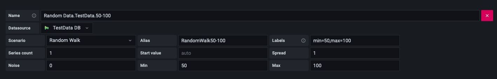
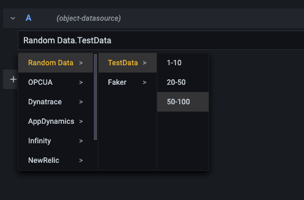

# Object datasource
## Vision
1. Have you ever had users that didn't know the details about how to make a query for a datasource, but needed information from that datasource?
2. Do you just want to provide your users a drop down showing a model? Much like a folder structure? 

## What does it do?
The object datasource tries to solve the problem between query creators (those knowledgable about the a query language) and query consumers (those knowledgable about the data a query produces)
Ideally, everyone interacting with data is knowledgable as both a query creator, and query consumer, but this is often not the case.

The object datasource allows query creators to create meaningful queryies, and associate them in a heiarchy that can be accessed by query consumers. 
Query consumers (those who are knowledgable about how to use and interpret the data) then have much easier access to the data they need to be successful.

## What does it look like?
Query creators write queries in the datasource config like so:



Query consumers access the data through a tree like heirarchy like so:


## How it runs

Panels and alert rules store only a reference to a query link (`linkId`, plus its `name`). The
backend looks the link up in the datasource settings each time a query runs and sends the link's
query to its target datasource through Grafana's `/api/ds/query`, so editing a link updates every
panel and alert that uses it.

The backend authenticates to Grafana's API as a service account:

- **Managed (preferred):** with the `externalServiceAccounts` feature toggle and
  `[auth] managed_service_accounts_enabled = true`, Grafana creates one for the plugin from the
  `iam` permissions in `plugin.json`.
- **Pasted:** otherwise, create a service account that can read and query the target
  datasources, and paste its token into the datasource settings.

Queries run as that service account, not as the viewer: anyone who can use this datasource sees
what its links return. Give the service account only the datasources the links need.

Dashboard variables in a link's query (`$var`, `${var:format}`) are filled in from the dashboard.
Alert rules have no dashboard variables, so links used in alerts shouldn't depend on them.

## Development

Requirements: Node 20+, Yarn 1, Go (the version in `go.mod`), and [mage](https://magefile.org).

```bash
yarn install
yarn dev          # build the frontend and rebuild on change
mage -v           # build the backend for all platforms
yarn typecheck && yarn lint && yarn test:ci && go test ./pkg/...
```

### Running it locally

The plugin runs in the local `aiden-grafana` container (<http://localhost:3333>), which mounts
this repo's `dist/`. Start that stack with `../aiden-assistant/scripts/container-up.sh`, then:

```bash
yarn deploy:local        # rebuild and restart the plugin's backend (a few seconds)
yarn deploy:local:full   # also restart Grafana, so browsers load the new frontend
```

Grafana caches the plugin's `module.js` in browsers by plugin version, which it reads at start-up.
After a fast deploy, hard-reload the browser to see frontend changes. Don't restart
`aiden-grafana` by itself: it comes back on a new IP that the services around it don't know.

## Learn more

- [Build a data source backend plugin tutorial](https://grafana.com/tutorials/build-a-data-source-backend-plugin)
- [Grafana documentation](https://grafana.com/docs/)
- [Grafana Tutorials](https://grafana.com/tutorials/) - Grafana Tutorials are step-by-step guides that help you make the most of Grafana
- [Grafana UI Library](https://developers.grafana.com/ui) - UI components to help you build interfaces using Grafana Design System
- [Grafana plugin SDK for Go](https://grafana.com/docs/grafana/latest/developers/plugins/backend/grafana-plugin-sdk-for-go/)
